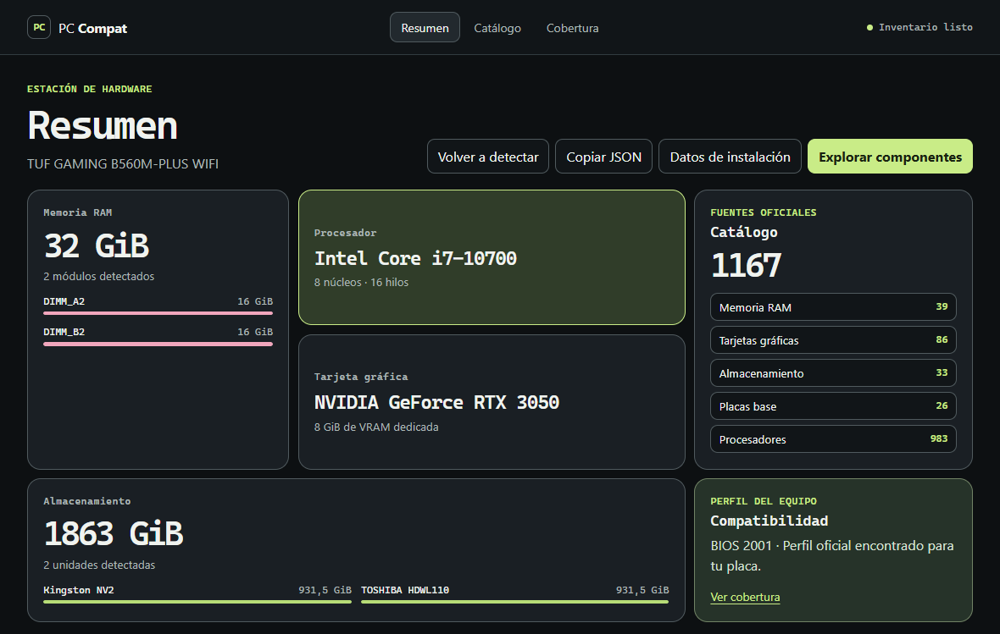

# PC Compat

**Comprueba qué componentes puedes instalar en tu PC antes de comprar.**

PC Compat es una aplicación de escritorio para Windows que detecta tu hardware y evalúa actualizaciones de **CPU, memoria RAM, GPU, almacenamiento y placa base**. El dictamen enlaza fichas técnicas, manuales y listas de soporte de los fabricantes.

PC Compat is a **Windows PC hardware compatibility checker** built with Rust and Tauri. It helps with PC building and upgrades by matching a local hardware inventory against official motherboard, CPU, GPU, memory and SSD specifications.

[English overview](README.en.md) · [Instalación](docs/instalacion.md) · [Guía de uso](docs/uso.md) · [Documentación](docs/README.md)

*Vista del resumen de PC Compat 0.4.0 con datos de un equipo de ejemplo.*

## Qué puedes comprobar

| Componente | Qué evalúa |
| --- | --- |
| Procesador | Socket, modelo exacto, revisión de placa y BIOS mínimo cuando la lista oficial lo permite. |
| Memoria RAM | Tipo DDR, formato, ranuras y capacidad al añadir o reemplazar módulos. |
| Tarjeta gráfica | Conector y carriles PCIe, generación, espacio útil y requisitos de alimentación del SKU. |
| Almacenamiento | Formato NVMe M.2 o SATA de 2,5 pulgadas y topología de la placa. |
| Placa base | Si puedes reutilizar tu CPU y RAM, y qué debes confirmar antes del montaje. |

El catálogo de **PC Compat 0.4.0** incluye **1.167 fichas** y **26 perfiles de placa**. Cubre hardware actual y descatalogado, desde Pentium, Athlon 64 y DDR2 hasta Ryzen, Core Ultra y gráficas Radeon, GeForce e Intel Arc recientes. Los datos sin evidencia suficiente quedan **por confirmar**. [Cobertura y fuentes](docs/catalogo.md)

## Empieza aquí

1. Instala PC Compat en Windows x64 y abre **Resumen** para detectar tu equipo.
2. Añade la potencia de la fuente y el espacio disponible para una gráfica si conoces esas medidas.
3. Busca la pieza en **Catálogo** y abre el dictamen. Cada comprobación indica qué verificó y qué queda por confirmar.

El escaneo y el catálogo integrado funcionan localmente. [Instalación](docs/instalacion.md) · [Interpretar un dictamen](docs/compatibilidad.md) · [Privacidad](docs/privacidad.md)

## Desarrollo y colaboración

~~~powershell
npm ci
npm run dev
~~~

[Requisitos y compilación](docs/desarrollo.md) · [Arquitectura](docs/arquitectura.md) · [Validación](docs/validacion.md) · [Historial de versiones](CHANGELOG.md)

Puedes colaborar reportando errores o proponiendo fichas de fabricantes. [Guía de contribución](CONTRIBUTING.md)

## Licencia

PC Compat es software propietario. La licencia permite instalar y usar binarios de canales autorizados y reserva la copia y redistribución del proyecto al titular, con las excepciones indicadas en el texto. [Licencia](LICENSE.md)
